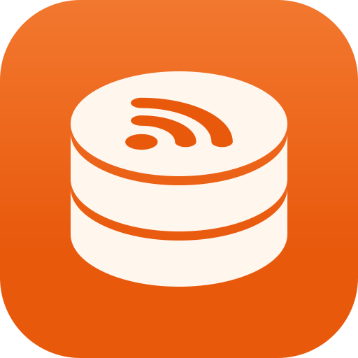

  

<h1 align="center">OPMLMan: the OPML and RSS feed manager for iPhone, iPad and Mac</h1>

  <strong>Know which feeds still matter. Clear out the rest.</strong> 
  <a href="https://opmlman.thechels.uk/">opmlman.thechels.uk</a>

---

OPMLMan imports the OPML file from your feed reader or podcast app, checks every feed, and tells you which are active, which have gone quiet, which have moved and which are gone for good. Merge lists, split them into podcasts, video and articles, and export clean OPML.

Free, with no ads, no accounts and no tracking, and an optional tip jar that unlocks nothing. Your collections sync through your own iCloud.

## Features

| | |
|---|---|
| **Collections** | Each imported OPML file is its own collection, with its folders. Types inside, feeds inside those. |
| **Feed health** | Active, slowing, dormant, moved, not found or failing, with thresholds you choose. |
| **Stats** | Latest item, earliest item, update frequency, items in the feed and the server's response. |
| **Duplicates** | The same feed written two ways, or redirecting to another, with your say before anything goes. |
| **Merge and split** | Merge collections into one, or split a collection into podcasts, video and articles. |
| **Export** | OPML per collection, combined or split by type. |
| **iCloud** | iPhone, iPad and Mac in step. |

## Pricing and requirements

- **Free**
- iPhone and iPad with iOS / iPadOS 18 or later (including the iPhone Duo, folded and unfolded)
- Mac with macOS 15 or later
- Apple Vision Pro, as the iPad app

---

## About this repository

The source of [opmlman.thechels.uk](https://opmlman.thechels.uk/): static HTML and CSS deployed to GitHub Pages by [`.github/workflows/pages.yml`](.github/workflows/pages.yml) on every push to `main`. Dependabot keeps the workflow's actions up to date.

### Design

The app icon is orange; the page around it is cool periwinkle and indigo ink with one ultramarine accent, roughly
opposite orange on the colour wheel, so the icon is the only warm thing on the page. Violet marks feeds in
trouble. Dark mode is deep indigo with the periwinkle lifted. The tokens are the `:root` blocks at the top of
`styles.css`. A light, dark or system toggle in the header works as on tools.thechels.uk: `theme.js` sets
`data-theme` on `<html>` before the page paints and remembers the choice in `localStorage`.

The page reads top to bottom: the question in large type on the gradient, beside the icon; a sample list you
can check (the Check button runs through it a row at a time, as the app does, only when asked, and nothing is
fetched: `check.js`); what the app does as a plain definition list on the indigo ink band; the privacy promise in
large type; and the questions. Statuses are told apart by shape (filled, half, dashed, arrow, square, ring) as
well as tone, so there's no rainbow of status colours.

The icon images (`images/opmlman-app-icon.svg` and `.png`, `favicon.ico`) are made from the icon's shapes by
the app's `tools/make_icon.py --flat <folder>`. `images/og-image.png` (1200 x 630) is the icon on periwinkle.

### Before the first deploy

- [x] App Store links, the `apple-itunes-app` meta tag, and `installUrl` and `sameAs` in the JSON-LD point at the app (id6832117624).
- [ ] When the app is live: add `screenshot` to the JSON-LD.
- [ ] Optional: the Ahrefs analytics tag the other sites use, with this site's own key.
- [ ] DNS: a CNAME for `opmlman.thechels.uk`, then turn on Pages with GitHub Actions as the source.

© 2026 OPMLMan · [thechels.uk](https://thechels.uk/)
